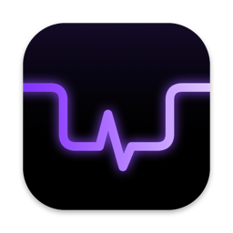
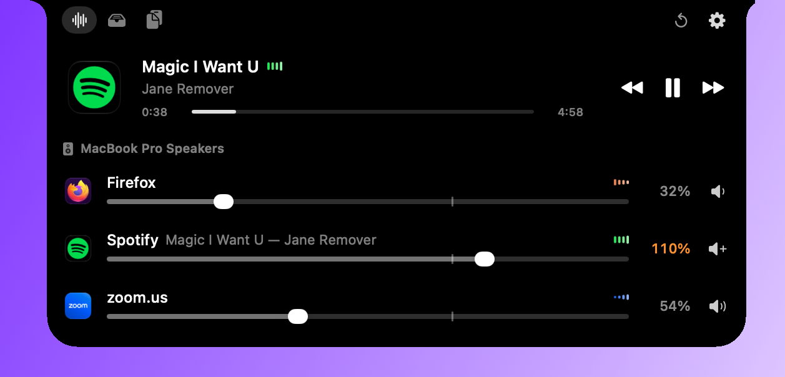
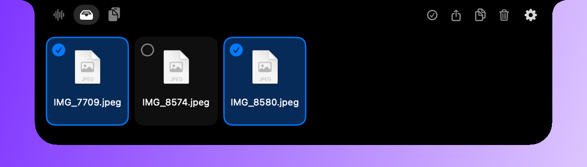
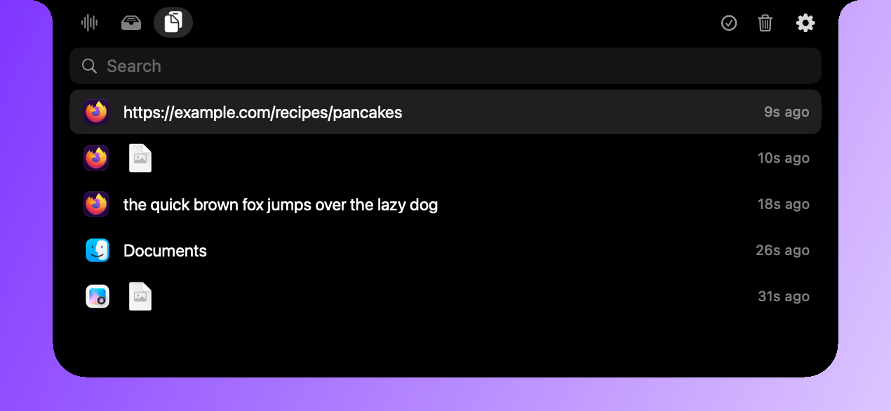

# nxtch



i wanted four small things on my mac: a volume knob per app, a place to park a file mid-drag, clipboard history, and play/pause without hunting for the window. thats usually four separate menu bar apps, each running all day. the notch was already there doing nothing, so i put all four in it.

| need | what nxtch does | what it leaves out |
| --- | --- | --- |
| per-app volume | 0 - 150% and mute for every app making sound, with a live meter | eq, effects, per-app output device |
| whats playing | title, artist, progress, previous / play-pause / next | album art |
| a shelf | drop anything on the notch, drag it out and the original moves there | conversion, renaming, sync |
| clipboard history | text, images and files. ⌃⌥V to search, return to paste | rich text, snippets, sync |

all four live in one app: a 1.3 MB binary, one process, apple frameworks only, no network. with the notch closed and nothing playing it uses 0.1 - 0.4% cpu and about 14 MB of memory. with audio playing, 1.1 - 1.5%. those are from my macbook.


## before you install

- macos 14.2 or later. process taps arrived in 14.2. ive only run it on macos 27.2, on one m-series macbook pro. 14.2 is the floor on paper, not something i tested.
- a mac with a notch. on other displays it falls back to a small pill at the top center. untested, i dont have one.

## who its not for

- you want album art. theres none, on purpose. getting it means loading unsigned code into a system program or downloading it from each service. you get the app icon instead.
- you want widgets: calendar, weather, battery, a camera mirror. boring.notch has those.
- you live on an external display. nxtch sits on the notch screen only.
- you need rich text out of your clipboard history. it keeps plain text, images and file reefrences.
- you copy passwords out of a browser extension or a terminal. those look like any other text, so they sit in the clipboard history for up to 7 days unless you delete them.
- you dont want an app that leans on private api. now playing uses apple's `MediaRemote` framework through `osascript`, and a future macos can break it.
- you wont click past apple's warning. i dont pay for apple's developer program, so the download isnt notarized and macos makes you allow it once. building it yourself skips that.

## install

download the zip from the [latest release](https://github.com/skyphose/nxtch/releases/latest), then:

1. unzip it (safari does that by itself) and drag `Nxtch.app` into Applications.
2. open it. macos says it cant verify nxtch, since apple hasnt notarized it. click done.
3. in system settings > privacy & security, scroll down and click "open anyway" next to nxtch, then confirm. once per download.

github builds that zip from the tagged source, not my laptop. the steps are in `.github/workflows/release.yml`. to check a zip came from there, with the [github cli](https://cli.github.com):

```bash
gh attestation verify nxtch-v0.6.0.zip --repo skyphose/nxtch
```

### build it yourself

needs apple's command line tools, about 2 GB: `xcode-select --install`. full xcode isnt needed. no warning to click past, since your mac built it.

```bash
git clone https://github.com/skyphose/nxtch.git ~/nxtch && ~/nxtch/build.sh --install
```

that builds it in under a minute, copies it to /Applications and starts it. the command line tools build i ran by pointing the build at them on a mac that also has xcode, not on a mac without it.

| | downloaded | built yourself |
| --- | --- | --- |
| update | download the new zip and replace the app | `cd ~/nxtch && git pull && ./build.sh --install` |
| uninstall | the three steps below | `~/nxtch/build.sh --uninstall`, then delete `~/nxtch` |
| an older version | any zip on the [releases page](https://github.com/skyphose/nxtch/releases), 0.6.0 and later | `git checkout v0.4.0 && ./build.sh --install` (0.4.0 and older need full xcode) |
| run without installing | | `./build.sh --run` |

### uninstall

built yourself: `build.sh --uninstall` quits nxtch and turns off launch at login. then it removes the app, its settings and caches, the shelf and the clipboard history in `~/Library/Application Support/nxtch`, and its audio and accessibility permissions. nothing is kept back, so theres no undo. ive run it on my own mac only. it prints whether the permissions were reset. launch at login i couldnt check from outside: look under system settings > general > login items if you had it on.

downloaded: no script comes in the zip, so three steps.

1. in nxtch's gear menu, turn off launch at login, then quit.
2. run this. it clears nxtch's permissions, settings, shelf and clipboard history:

   ```bash
   tccutil reset All dev.nxtch.app; defaults delete dev.nxtch.app; rm -rf ~/Library/Application\ Support/nxtch
   ```

3. drag Nxtch.app from Applications to the trash.

do them in that order: macos only finds the permissions while the app is still there. either way, files you dropped on the shelf from elsewhere are only referenced, so those stay where they were.

### signing

for building it yourself. optional, and it needs xcode. `build.sh` signs with your apple development certificate if you have a valid one. a free apple id is enough: sign in under xcode > settings > accounts. check it took with `security find-identity -v -p codesigning`. if that says 0 valid identities, install apple's "worldwide developer relations - g3" intermediate from apple.com/certificateauthority - xcode didnt add it on my mac. with that, macos keeps the audio and accessibility grants across rebuilds. without one it signs ad hoc, and macos asks again after every update. set `SIGN_ID` to pick a specific identity.

the grants surviving a rebuild is untested. my certificate still shows 0 valid identities, so every build on my mac has been ad hoc.

ad hoc has a cost beyond the nagging: you get used to re-approving audio and accessibility. only approve those prompts right after an update you ran yourself. if one shows up out of nowhere, something replaced the app, so deny it.

## using it

| | |
| --- | --- |
| open | rest the pointer on the notch, drag something onto it, or press ⌃⌥V |
| close | move away, press esc, or click somewhere else |
| tabs | icons left of the notch: media, shelf, clipboard. or swipe sideways with two fingers |
| settings | gear right of the notch: launch at login, activity beside notch, full screen, clipboard history, quit |

### media



whats playing (title, artist, progress, the app its in) with previous, play/pause and next. below that, one row per app making sound: volume 0 - 150%, mute, and a live level meter.

- a slider sticks to 100% as it passes, within 2%. hold ⇧ while dragging to turn that off.
- the reset button puts every app back to 100%. its at the top right of the media tab, and only shows when an app is muted or off 100%.
- closed, the notch shows an icon for every app making sound on its left. up to four. one level meter sits on the right, and its bars follow the first app only.
- the meter takes its color from the icons: green for spotify, orange for firefox. two apps fade from one color to the other. three or more make a wheel.
- an icon with several colors gets one blended color, so chrome comes out orange too. chrome and firefox toegther is a flat orange. an icon with no real color gives white.

### shelf



drag anything onto the notch to park it: files, images, links, text. items are tmeporary. drag one out and drop it somewhere, and it leaves the shelf.

the shelf MOVES files. it doesnt copy them. dropping a file on the notch only notes where the file is. drag it out into a finder folder and the original goes there, from wherever it was. nothing is duplicated, on the shelf or after. that started in 0.4.0. before it, your own files copied out by default.

- the shelf grows down a row at a time, four tiles a row, up to three rows. past that it scrolls.
- with two or more tiles, each gets a circle in its corner. click it to tick the tile, again to untick it. the check mark button ticks everything. drag a ticked tile and every ticked one goes with it. the buttons and the right-click menu act on the ticked tiles, or on everything when none are.
- hold ⌥ while dropping to copy and leave the original in place. hold ⌘ to insist on a move.
- a file dragged in from an app that only lets you copy it still moves when you drag it out, since the shelf tries a move on every file. hold ⌥ for those. i havent found which apps do this.
- the destination does the move, not nxtch. an app that only reads the file (a browser upload, a mail attachment) leaves the original alone. finder should copy instead when the folder is on another disk. untested, i only tried one disk.
- text, links, images and file promises (mail, photos, screenshots) get saved in `~/Library/Application Support/nxtch/Shelf`, kept out of time machine. those move out, so no copy is left behind. anything over 1 GB is skipped. files nxtch only references have no limit. if the place you drop one only takes its path instead of moving or copying it, it stays on the shelf.
- while you drag an item, a delete square shows up. drop it there to take it off the shelf. your original files are never trashed.
- double-click opens an item. right-click for open, show in finder, copy, airdrop or delete.

### clipboard



press ⌃⌥V anywhere and type to search. ↑/↓ moves the selection, return pastes into the app you were in.

- click a row to copy it. right-click to paste, pin or delete.
- to delete some entries and keep the rest, click the check mark button, pick the rows, then the trash. ⌘-click a row does the same without the button. the trash deletes what you picked, pinned or not. outside select mode it clears everything unpinned.
- anything a password manager marks as concealed or transient is never recroded. nothing is recorded while a password manager is in front, or was at any point since the last check (twice a second), since not all of them mark their items. the list is in `Clipboard.swift`. four of the ids on it (macpass, strongbox, keeper, nordpass) i wrote down without an install to check against.
- a password copied from a browser extension or a terminal looks like any other text, so that still gets recorded. delete it, or pause recording first.
- unpinned items are dropped after 7 days.
- things copied on your iphone (universal clipboard) arent recorded. untested.
- text is capped at 50,000 characters. images over 20 MB or 50 megapixels are skipped.
- history lives in `~/Library/Application Support/nxtch/Clipboard`, readable by your user only and kept out of time machine.

## permissions

| permission | asked when | why |
| --- | --- | --- |
| system audio recording | the first time an app plays sound | per-app volume and the meters read each app's audio |
| accessibility | the first time you paste from clipboard history | return/paste sends ⌘V to the app you were in |

with an ad hoc signature macos may ask again after every update. signing with your own certificate stops that (see signing). return only pastes if the app you were in is frontmost again. ohterwise the item just stays on the clipboard.

## how it works

**per-app volume.** core audio process taps. for an app set to anything but 100%, nxtch taps its audio and mutes the original. then it plays it back through the default output at your gain, ramped and run through a soft limiter. at 100% the app's audio isnt touched.

**meters.** the tap callback splits each app's audio into four bands with one-pole filters. meters are drawn with `CALayer`s and only run where you can see them.

**now playing.** since macos 15.4, `MediaRemote` only answers apple-signed programs. so nxtch asks through `osascript` (jxa), which is apple-signed. a long-running helper reports title, artist and position, and quits when nxtch quits. the playback buttons send comamnds the same way, so they need no permission.

**the notch panel.** a borderless, non-activating `NSPanel` above the menu bar. it tries hard to stay out of the way:

- it only opens after you rest on the hardware notch, or when you drag something onto it.
- only the visible black shape takes clicks. evreything around it passes through.
- it takes keyboard focus only for clipboard search, and hands it back when it closes.
- its hidden in full-screen apps unless you turn that on.

## security

- signed with hardened runtime, so another process cant inject code into nxtch and borrow its audio or accessibility access. with your own certificate, the grants follow anything signed with it, so a program running as you that can sign with it keeps them too.
- names of dropped files are cleaned before saving. a name cant leave the shelf folder, hide itself or fake its extension with right-to-left characters.
- files nxtch saves get the quarantine flag, so gatekeeper still checks them when you open one.
- nxtch only ever deletes files inside its own shelf and clipboard folders, even if its saved lists were edited or a folder was swapped for a link. when a shelf file moves, the destination moved it. nxtch never moves or deletes your originals itself.
- now-playing data comes from any app or web page, so its times are clamped before use.

to report a hole, see [SECURITY.md](SECURITY.md).

what it costs to run, and what stays out on purpose, is in [SCOPE.md](SCOPE.md). what changed in each version is in [CHANGELOG.md](CHANGELOG.md).

## project layout

```
Sources/Nxtch/
  main.swift          app entry, settings
  Support.swift       timing, animation curves, logging, global shortcut, ⌘V, folders on disk
  NotchWindow.swift   panel, tabs model, mouse/drag/keyboard handling
  NotchView.swift     notch shape, open/closed shells, tab bar
  LevelMeter.swift    the meters, their shared timer, and the color taken from an app icon
  MediaTab.swift      now-playing card, mixer rows
  ShelfTab.swift      shelf tiles, delete zone, drag source
  ClipboardTab.swift  search field, history rows
  MixerModel.swift    finds which apps make sound, keeps taps in sync, saves volumes
  Audio.swift         core audio helpers, process tap, real-time render callback
  NowPlaying.swift    now-playing helper and playback commands (osascript)
  Shelf.swift         shelf store: drops, selection, thumbnails
  Clipboard.swift     clipboard history store
Tests/NxtchTests/     the rules that need no notch: file names, expiry, parsing, levels, colors
.github/workflows/release.yml   builds the release zip from a version tag
Resources/Info.plist
Resources/AppIcon.icns       the app icon
Resources/icon.png           the same icon, for this readme
Resources/make-icon.swift    draws it
Resources/screenshots/       the pictures in this readme
build.sh
CHANGELOG.md
SCOPE.md
SECURITY.md
```

`swift test` runs the tests (that one needs full xcode). 22 of them, none touch audio, the pasteboard or the screen. those parts i test by hand.


## license

mit. see [LICENSE](LICENSE).
